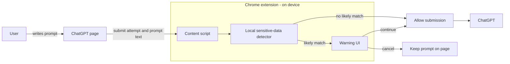

# Browser Guard

> **TL;DR:** Browser Guard is a Chrome extension that checks ChatGPT prompts on-device for likely sensitive information and warns you before submission. Your prompt text is not sent to Browser Guard servers.

Browser Guard is a Chrome extension that helps prevent sensitive information from being shared with public AI tools. Its first version targets ChatGPT and warns before a prompt containing likely sensitive information is submitted.

## MVP scope

- Chrome extension using Manifest V3
- Public ChatGPT (`chatgpt.com`)
- On-device detection of likely U.S. Social Security numbers, driver's license numbers, and health-related information
- A warning lets the user cancel or continue submitting the prompt
- Prompt text is not sent to Browser Guard servers

Detection is best-effort: it may miss sensitive information or flag harmless text. Health-related information can be difficult to identify reliably, so the initial rules should be treated as a starting point rather than a guarantee.

## Proposed architecture

The content script observes prompt submissions on ChatGPT, runs local checks, and either allows submission or presents a warning. No prompt text needs to leave the browser for detection.

## Try it locally

1. Open `chrome://extensions` in Chrome and enable **Developer mode**.
2. Select **Load unpacked** and choose this repository directory.
3. Open ChatGPT and try a prompt containing a test pattern such as `SSN 123-45-6789`. Choose **Go back** or **Continue anyway** in the warning.

Run detector tests with `npm test` (Node.js required).
